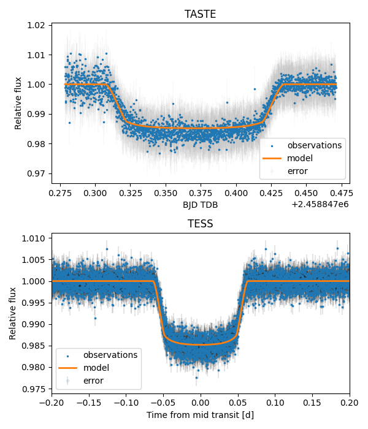

# exoplanet-transit-analysis

Photometric analysis of the transits of the hot Jupiter **WASP-12b**, combining ground-based observations from the **TASTE** program (Asiago) with space-based photometry from **TESS** (Sectors 43, 45 and 71).



The workflow goes from raw CCD frames to a calibrated transit model, and finally to a joint Bayesian (MCMC) fit of the model to all the data, from which the planetary and stellar parameters are derived.

## Workflow

```
Raw CCD images ──► Calibration ──► Differential photometry ──► Light-curve cleaning
 (bias, flat)    (corrected_files)       (TASTE)                 (TASTE + TESS)
                                                                      │
                                                                      ▼
                                       Transit model (batman) ──► Joint MCMC fit (emcee)
                                       + limb darkening (ldtk)          │
                                                                        ▼
                                                      Posteriors + derived parameters
```

1. **Data reduction (TASTE)**: bias and flat-field calibration of the raw images, aperture photometry, and differential photometry against reference stars. Several apertures and reference-star choices are tested, and the best light curve is selected.
2. **Data cleaning (TESS)**: the SAP light curves of Sectors 43, 45 and 71 are masked and detrended (Huber spline), producing clean light curves.
3. **Transit model**: a theoretical transit light curve is built with `batman` using literature parameters, with limb-darkening coefficients computed for each filter with `ldtk`.
4. **Model fit**: the model is fitted jointly to the TASTE and TESS data with an MCMC sampler, and physical parameters are derived from the posteriors.

## Repository structure

```
exoplanet-transit-analysis/
├── README.md
├── images/                  # Figures used in the analysis and documentation
└── WASP-12 LAB/
    ├── bias/                # Bias frames
    ├── flat/                # Flat-field frames
    ├── data/                # Raw science frames
    ├── corrected_files/     # Calibrated (bias/flat-corrected) images
    ├── TASTE/               # Notebooks for TASTE data reduction and cleaning
    │   └── output_files/    # Differential light curves (pickle files)
    ├── TESS/                # Notebooks for TESS data cleaning
    │   └── output_files/    # Cleaned TESS light curves (pickle files)
    ├── DATA ANALYSIS/
    │   ├── 1_transit_model.ipynb
    │   ├── 2_model_fit.ipynb
    │   └── output_files/    # Saved MCMC sampler and other results
    └── conda_requirements.txt
```

## Notebooks

### Data reduction

The `TASTE/` and `TESS/` folders contain the Jupyter notebooks that reduce and clean the two datasets. Their outputs (time stamps in BJD<sub>TDB</sub>, fluxes, and errors) are saved as pickle files in the respective `output_files/` folders and are the inputs for the analysis notebooks.

### `1_transit_model.ipynb`: building the transit model

Produces a preliminary transit model and compares it with the data before any fitting.

- Loads the selected TASTE (differential photometry, aperture 08) and TESS (Sector 43, SAP masked + Huber spline) light curves.
- Builds a transit light curve with [`batman`](https://github.com/lkreidberg/batman), using parameters from the literature (ExoFOP / TOI table): reference epoch `t0`, period `P ≈ 1.0914 d`, scaled radius `Rp/R*`, scaled semi-major axis `a/R*`, inclination, and a circular orbit.
- Overplots the model on the TASTE data and on the phase-folded TESS data.
- Computes quadratic **limb-darkening coefficients** with [`ldtk`](https://github.com/hpparvi/ldtk) for the two filters (SDSS r' for TASTE, TESS band), using the host-star parameters (T<sub>eff</sub>, log g, [Fe/H]) and Monte Carlo sampling of their uncertainties.
- Shows that the corrected limb darkening improves the shape of the model, while a residual timing offset remains in the TASTE data. This is likely caused by a small error in the period propagated over the time between the TESS and TASTE observations.

Limb-darkening coefficients from `ldtk`:

| Filter | u1 | u2 |
|---|---|---|
| SDSS r' (TASTE) | 0.51 ± 0.01 | 0.13 ± 0.03 |
| TESS | 0.41 ± 0.01 | 0.13 ± 0.03 |

The `ldtk` uncertainties do not include systematics from the stellar atmosphere models, so in the fit they are used as broadened priors and the coefficients are left free to vary.

### `2_model_fit.ipynb`: joint MCMC fit

Fits the transit model simultaneously to the TASTE light curve and to TESS Sectors 43, 45 and 71.

**Model (14 free parameters)**

| Index | Parameter |
|---|---|
| 0 to 4 | `t0`, period, `Rp/R*`, `a/R*`, inclination (shared by all datasets) |
| 5, 6 | TESS limb-darkening coefficients `u1`, `u2` (shared by all sectors) |
| 7, 8 | TASTE limb-darkening coefficients `u1`, `u2` |
| 9 to 11 | Quadratic polynomial trend for the TASTE data |
| 12, 13 | Jitter terms for TESS and TASTE, added in quadrature to the flux errors |

Eccentricity is fixed to 0 (circular orbit). The polynomial trend is *multiplied* into the TASTE model rather than dividing it out of the data, so the errors do not need to be rescaled. For this reason the TASTE fit uses the differential photometry *before* normalisation.

**Statistical setup**

- **Likelihood**: Gaussian and uncorrelated, summed over the four datasets.
- **Priors**: Gaussian priors on the four limb-darkening coefficients (centred on the `ldtk` values, σ = 0.10, intentionally wider than the `ldtk` errors). All other parameters have uniform priors within physical boundaries, which also reject unphysical values such as negative radii.
- **Sampler**: [`emcee`](https://github.com/dfm/emcee) affine-invariant ensemble sampler, 50 walkers × 20,000 steps, run in parallel with `multiprocessing`. The sampler is saved to `output_files/emcee_sampler_second_run.p` and reloaded on later runs instead of re-sampling.
- **Posterior extraction**: 2,500 burn-in steps discarded and chains thinned by 100, giving 8,750 samples. Parameter values are the median with the 15.9 / 84.1 percentile interval.
- **Diagnostics**: chain traces to check convergence, corner plot of the posteriors, and model-vs-data plots with TASTE residuals and phase-folded TESS data.

**Results (median and 1σ interval)**

| Parameter | Value |
|---|---|
| Mid-transit time `t0` (BJD<sub>TDB</sub>) | 2459550.24325 ± 0.00007 |
| Period `P` (d) | 1.0914165 ± 0.0000002 |
| `Rp/R*` | 0.1175 ± 0.0004 |
| `a/R*` | 2.94 ± 0.03 |
| Inclination (°) | 81.4 ± 0.5 |
| TESS `u1`, `u2` | 0.32 ± 0.04, 0.12 ± 0.07 |
| TASTE `u1`, `u2` | 0.44 ± 0.08, 0.11 ± 0.08 |

**Derived parameters**

- **Planetary radius**: `Rp/R*` times the stellar radius (1.57 R<sub>☉</sub>, Hebb et al. 2009), converted to Jupiter radii: about 1.79 ± 0.06 R<sub>Jup</sub>.
- **Stellar density**: from `a/R*` and the period via Kepler's third law (Sandford & Kipping 2017): about 0.403 ± 0.011 g cm<sup>-3</sup>. A version corrected for the planet's mass (from ExoFOP) gives a nearly identical value.

**Optional section**: the notebook also includes a commented-out example using differential evolution (`PyDE`) to find a starting point for the MCMC when no good initial guess is available. Nested samplers such as `dynesty` or `ultranest` are mentioned as alternatives.

## Installation

The environment is described in `WASP-12 LAB/conda_requirements.txt`:

```bash
conda create --name <env_name> --file "WASP-12 LAB/conda_requirements.txt"
conda activate <env_name>
```

Additional packages are installed with pip. Run this from a terminal, not from inside a notebook:

```bash
pip install batman-package astroquery ldtk==1.7 emcee corner
```

Note that `batman` is published on pip as `batman-package`, and `ldtk` must be pinned to version 1.7 because newer versions are not compatible with the rest of the environment.

## Usage

1. Run the reduction and cleaning notebooks in `TASTE/` and `TESS/` to produce the light curves in their `output_files/` folders.
2. Run `DATA ANALYSIS/1_transit_model.ipynb` to build and inspect the transit model.
3. Run `DATA ANALYSIS/2_model_fit.ipynb` to run the MCMC fit and derive the final parameters. The first run takes a long time; later runs reload the saved sampler.

The notebooks load data with relative paths (e.g. `../TASTE/output_files/`), so run them from within their own folders.

## Tools and references

- [`batman`](https://github.com/lkreidberg/batman): transit light-curve modelling (Kreidberg 2015)
- [`ldtk`](https://github.com/hpparvi/ldtk): limb-darkening toolkit (Parviainen & Aigrain 2015)
- [`emcee`](https://github.com/dfm/emcee) and [`corner`](https://github.com/dfm/corner.py): MCMC sampling (Foreman-Mackey et al. 2013) and posterior visualisation
- [`astropy`](https://www.astropy.org/) / [`astroquery`](https://astroquery.readthedocs.io/): astronomy utilities and archive access
- [ExoFOP](https://exofop.ipac.caltech.edu/tess/): literature transit parameters for the target
